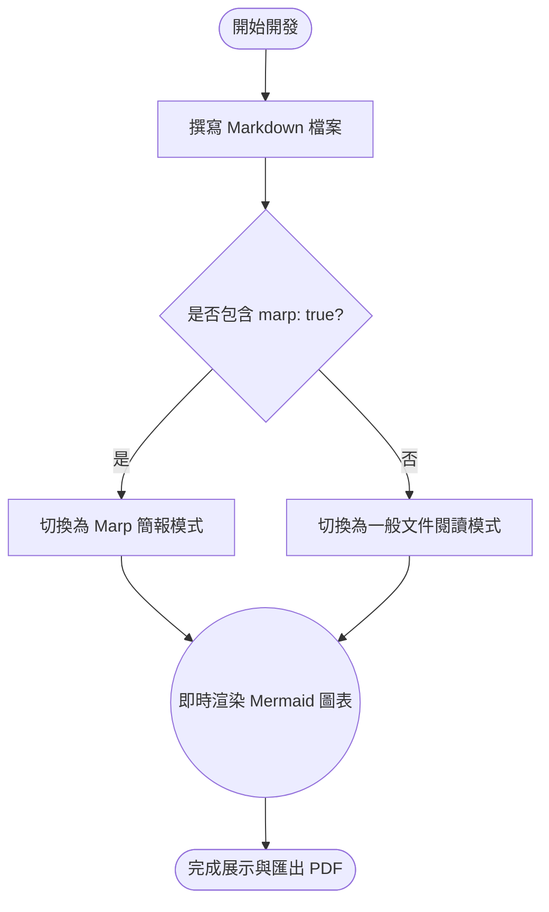

# Markdown Marp & Mermaid 預覽套件 (Orca Extension)

這是為 **[Orca](https://github.com/stablyai/orca)** 打造的強大 Markdown 增強預覽自訂編輯器（Custom Editor）。

整合了 **[Marp](https://marp.app/)** 投影片簡報引擎與 **[Mermaid](https://mermaid.js.org/)** 架構圖表渲染引擎，提供雙模式即時預覽、簡報全螢幕播放、Orca 介面深淺主題自動連動與 PDF 列印匯出功能。

---

## ✨ 主要特色 (Features)

1. **雙預覽模式自動偵測**：
   - **Marp 簡報模式**：當 Markdown 文件的 YAML Frontmatter 含有 `marp: true` 時，自動啟動 Marp 投影片簡報模式。
   - **文件預覽模式**：一般 Markdown 文件自動以清晰優雅的 GitHub 風格進行排版呈現。
   - 頂部工具列亦支援隨時手動強制切換 `[ 自動 ]`、`[ 簡報 ]` 或 `[ 文件 ]`。

2. **完整支援 Mermaid 即時圖表**：
   - 支援在簡報與一般文件中內嵌 ```` ```mermaid ```` 語法代碼區塊。
   - 支援 Flowchart（流程圖）、Sequence Diagram（循序圖）、Class Diagram（類別圖）、State Diagram（狀態圖）、ER Diagram（實體關聯圖）、Gantt（甘特圖）、Pie（圓餅圖）、Git Graph 等。
   - 圖表語法錯誤時即時提示，不影響整體頁面渲染。

3. **Marp 簡報專業播放與瀏覽體驗**：
   - 支援 **單頁居中投影片** 與 **連續垂直捲動** 兩種版面檢視。
   - 內建投影片分頁控制（上一頁、下一頁、總頁數指示器）。
   - 支援完整鍵盤導航：`Space` / `→` / `PgDn` 下一張，`←` / `PgUp` 上一張，`Home` 第一張，`End` 最後一張。
   - 支援 **一鍵全螢幕簡報播放**（快捷鍵 `F` 或 `F5`）。

4. **深度 Orca 整合**：
   - 透過 `window.orca.document.session()` 與編輯器即時同步，打字時無延遲即時更新。
   - 即時響應 Orca 深色 / 淺色主題變更，Mermaid 與代碼高亮色彩自動無縫切換。
   - 完全離線運作，遵循嚴格的 CSP 安全規範（所有核心庫均本地打包，無任何外部 CDN 依賴）。

5. **匯出與列印**：
   - 內建 `🖨️ 匯出 PDF` 按鈕，針對簡報模式自動設定每張投影片 16:9 滿版分頁，方便直接另存為簡報 PDF。

---

## 🚀 安裝方式 (Installation)

### 方式一：在 Orca 中透過 Marketplace 來源安裝
1. 開啟 Orca，前往 **Settings → Plugins → Marketplace Sources**。
2. 確認已加入來源：
   - **URL**: `https://github.com/fuevaco/manmonths.git`
   - **Ref / Branch**: `main`
3. 在插件列表中找到 **Markdown Marp & Mermaid 預覽**（`fuevaco.marp-mermaid-preview`），點選 **Install** 安裝並啟用。

### 方式二：本機開發與測試模式 (Local Development)
1. 開啟 Orca，前往 **Settings → Plugins → Local Development**。
2. 點選 **Add**，將路徑指向此套件目錄：
   ```text
   F:\Orca_繁中語言套件\plugins\marp-mermaid-preview
   ```
3. 即可在 Orca 中立即載入並測試。

---

## 💡 使用指南 (Usage)

在 Orca 編輯器中打開任何 `.md` 或 `.markdown` 檔案時：
1. 在編輯器分頁右上角的檢視切換列（View Toggle），除了原本的 **Source** 外，會出現 **Marp & Mermaid 預覽** 選項。
2. 點擊切換為預覽檢視，即可享受即時渲染的簡報與圖表！

---

## 📝 語法範例 (Syntax Examples)

### 1. Marp 簡報語法
在 Markdown 文件開頭加入 `marp: true`：
````markdown
---
marp: true
theme: default
paginate: true
header: "技術分享會 2026"
footer: "Orca Agentic IDE"
---

# 歡迎使用 Marp 簡報 🚀

這是第一張投影片的主標題！
- 支援重點條列
- 支援粗體與斜體

---

<!-- _theme: gaia -->
<!-- _class: lead -->

# 第二張投影片 (Gaia 主題)

這張投影片使用了特別的版型風格！
````

### 2. Mermaid 圖表語法
在簡報或文件中隨時加入 `mermaid` 代碼區塊：
````markdown

````

---

## ⌨️ 快捷鍵速查 (Keyboard Shortcuts)

| 快捷鍵 | 動作 |
| :--- | :--- |
| `→` / `↓` / `Space` / `PageDown` | 下一張投影片 |
| `←` / `↑` / `Shift + Space` / `PageUp` | 上一張投影片 |
| `Home` | 回到第一張投影片 |
| `End` | 跳至最後一張投影片 |
| `F` / `F5` | 進入 / 退出全螢幕簡報播放 |
| `Esc` | 退出全螢幕 |

---

## 📦 技術架構 (Architecture)

- **Execution Profile**：`sandboxed-ui`
- **Plugin API**：v1
- **核心依賴**：
  - `@marp-team/marp-core`: v4.4.0（本地打包）
  - `mermaid`: v12.3.0（本地打包）
  - `markdown-it`: GFM Markdown 解析器
  - `highlight.js`: 程式碼高亮著色器
